# Decoupling Candidate Dual AGNs from Chance Superpositions in the GOTHIC Survey via a Deep-Learning Framework


## Table of Contents
- [Overview](#overview)
- [Repository Structure](#repository-structure)
- [Pipeline](#pipeline)
- [Quick Setup](#quick-setup)
- [Results](#results)
- [Acknowledgement](#acknowledgement)
- [Citation](#citation)
- [License](#license)

---

## Overview

Dual Active Galactic Nuclei (DAGN) represent an important stage in the evolution of merging galaxies and supermassive black holes. However, identifying DAGN systems in large imaging surveys remains challenging due to projection effects and foreground stellar contamination.

This repository accompanies our research work revisiting 46,021 galaxies previously rejected as DAGN candidates by the GOTHIC (Graph-Boosted Iterated Hill Climbing) pipeline. Unlike GOTHIC, which relied on heuristic-based approaches, this work uses a modern deep-learning framework based on the YOLOv11x-OBB object detection architecture to distinguish genuine dual nuclei from foreground stars and other spurious alignments in SDSS imaging data.

The final model achieves:

- **Precision:** 0.919
- **Recall:** 0.905
- **F1-score:** 0.912

This repository includes:

- Dataset preparation and preprocessing pipelines
- YOLOv11x-OBB training and inference workflows
- Post-processing and filtering utilities
- Projected separation estimation scripts
- Analysis notebooks and reproducible experiment configurations

The final pipeline identifies a large population of likely dual-nuclei candidates with projected separations down to kiloparsec scales.

---

## Repository Structure

```text
├───configs             Experiment Configurations
│   ├───data
│   ├───post-process
│   ├───predict
│   └───train
├───data                Data used in the paper
│   ├───baselineModel
│   │   ├───test
│   │   ├───train
│   │   │   └───labels
│   │   └───val
│   │       └───labels
│   └───finalModel
│       ├───test
│       ├───train
│       │   └───labels
│       └───val
│           └───labels
├───docs               Detailed documentation
├───figures            Figures used in the paper
├───notebooks           Analysis notebooks
├───results             Generated catalogs and prediction outputs
│   ├───baselineModel
│   │   └───sample
│   │       ├───images
│   │       └───labels
│   └───finalModel
│       └───random_sampling
│           ├───200_random_sampling
│           │   ├───images
│           │   └───labels
│           ├───100_random_sampling_10_arc
│           │   ├───images
│           │   └───labels
│           ├───100_random_sampling_12_5_arc
│           │   ├───images
│           │   └───labels
│           ├───dual-nuclei
│           ├───pure-stars
│           └───star-galaxy-overlap
├───runs                Training checkpoints and metrics
│   ├───baselineModel
│   │   └───weights
│   └───finalModel
│       └───weights
└───src              Core pipeline scripts
    ├───post-process
    ├───pre-process
    ├───predict
    └───train
```

---

## Pipeline

The repository follows the workflow below:

1. Dataset preparation and download
2. Model training
3. Prediction and inference
4. Post-processing and filtering
5. Projected separation estimation
6. Statistical analysis and visualization

Detailed documentation for each step is available under the [`docs/`](docs/) directory.

<p align="center" style="background:white; padding:5px">
  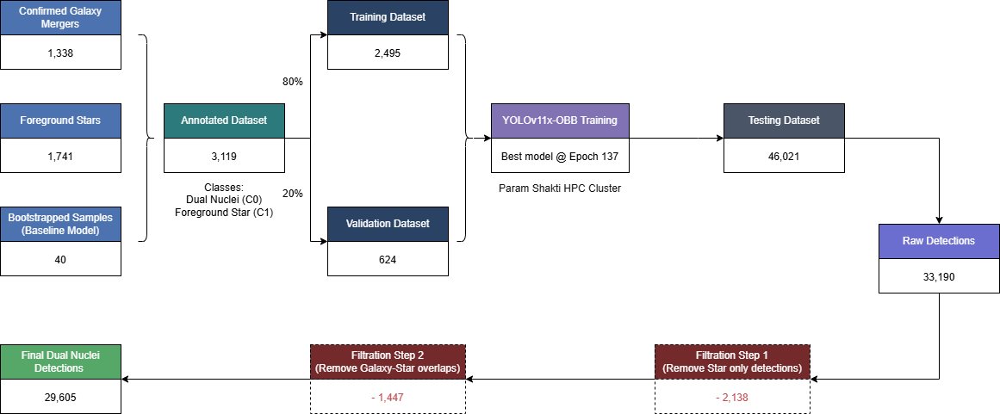
</p>

---

## Quick Setup

Most paths and variables are already configured through YAML configuration files under the `configs/` directory. These can be modified as needed for custom environments or datasets.

### 1. Clone the Repository

```bash
git clone https://github.com/BhaveshMukheja/yolo-dagn.git

cd yolo-dagn
```

---

### 2. Install Requirements

> Python and Jupyter Notebook should already be installed.

Using pip:

```bash
pip install -r requirements.txt
```

Or create a separate conda environment:

```bash
conda env create -f environment.yml

conda activate yolo-dagn
```

---

### 3. Download the Dataset

The repository includes dataset CSV files under the `data/` directory. These CSV files are used to download SDSS images and organize them into YOLO-compatible directory structures.

Example:

```bash
python src/pre-process/download_sdss.py --config configs/data/finalModel.yaml --dataset train
```

After downloading, the dataset structure will resemble:

```text
data/finalModel/train/
├── images/
└── labels/
```

You may modify output paths directly in the configuration files if needed. Ensure that image and label directories remain aligned for YOLO training.

Additional details are available in: [`docs/dataset.md`](docs/dataset.md)

---

### 4. Training

Run the training pipeline using:

```bash
python src/train/train.py --config configs/train/finalModel.yaml
```

Training outputs and validation metrics are saved under:

```text
runs/
```

Additional details: [`docs/training.md`](docs/training.md)

---

### 5. Prediction / Inference

```bash
python src/predict/predict.py --config configs/predict/finalModel.yaml
```

Additional details: [`docs/prediction.md`](docs/prediction.md)

---

### 6. Post-Processing

### 6a. Remove Star-Only Detections

```bash
python src/post-process/remove_star_only_detections.py
```

### 6b. Remove Star-Galaxy Overlaps

```bash
python src/post-process/remove_overlap.py
```

These filtering steps leave only likely dual-nuclei detections.

Additional details: [`docs/postprocessing.md`](docs/postprocessing.md)

---

### 7. Projected Separation Estimation

```bash
python src/post-process/projected_separation.py
```

This step computes projected angular and physical separations for the final detections.

Additional details: [`docs/projected_separation.md`](docs/projected_separation.md)

---

### 8. Analysis and Visualization

Jupyter notebooks for:

- histogram generation
- statistical analysis
- validation metric visualization
- projected separation analysis

are available under:

```text
notebooks/
```

## Results

### Class-specific validation performance metrics
| Class           | P     | R     | F1    | Acc.  | LR⁺  |
| --------------- | ----- | ----- | ----- | ----- | ---- |
| Dual nuclei     | 0.967 | 0.803 | 0.877 | 80.3% | 47.2 |
| Foreground star | 0.835 | 0.838 | 0.837 | 83.8% | 16.4 |

### Sensitivity analysis of dual-nucleus detection
| Subset      | Population (N) | Sample (n) | Accuracy (p̂) | 95% CI on p̂   | Projected Count         |
| ----------- | -------------: | ---------: | ------------: | -------------- | ----------------------- |
| Full sample |         29,605 |        200 |         0.545 | [0.476, 0.614] | 16,135 [14,092, 18,171] |
| d ≤ 10″     |         23,309 |        100 |         0.590 | [0.494, 0.686] | 13,752 [11,516, 15,984] |
| d ≤ 12.5″   |         28,660 |        100 |         0.620 | [0.525, 0.715] | 17,769 [15,047, 20,491] |

### Validation Results

<p align="center">
  <!-- 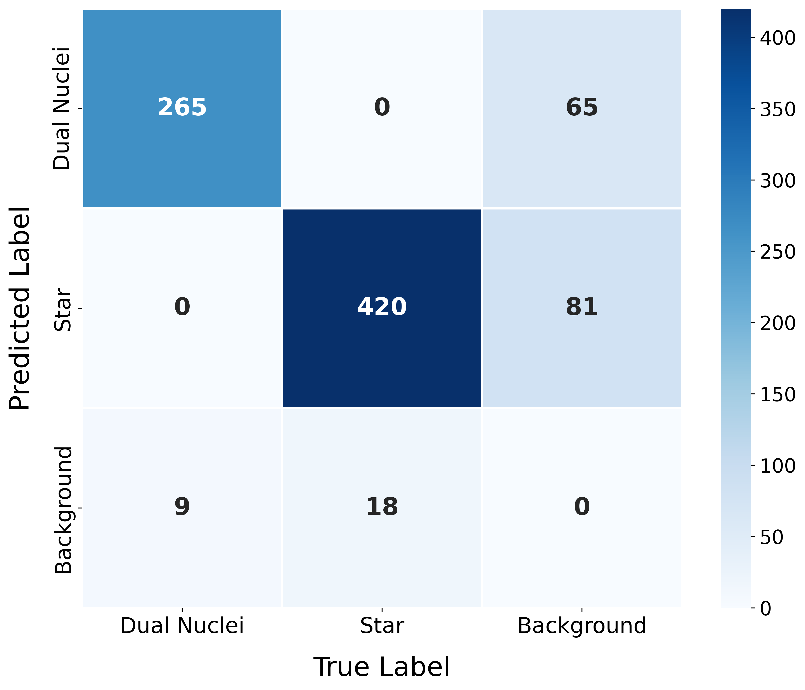 -->
  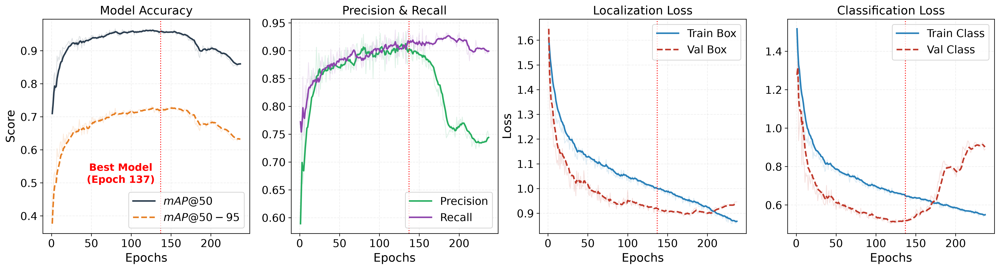
</p>

### Sample Dual-Nuclei Detections

<p align="center">
  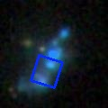
  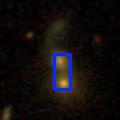
  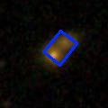
</p>

### Sample Galaxy+Star Overlap Detections

<p align="center">
  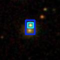
  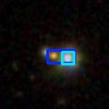
  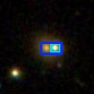
</p>

### Sample Star-Only Detections

<p align="center">
  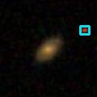
  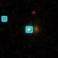
  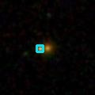
</p>

### Projected Separation Distribution

<p align="center">
  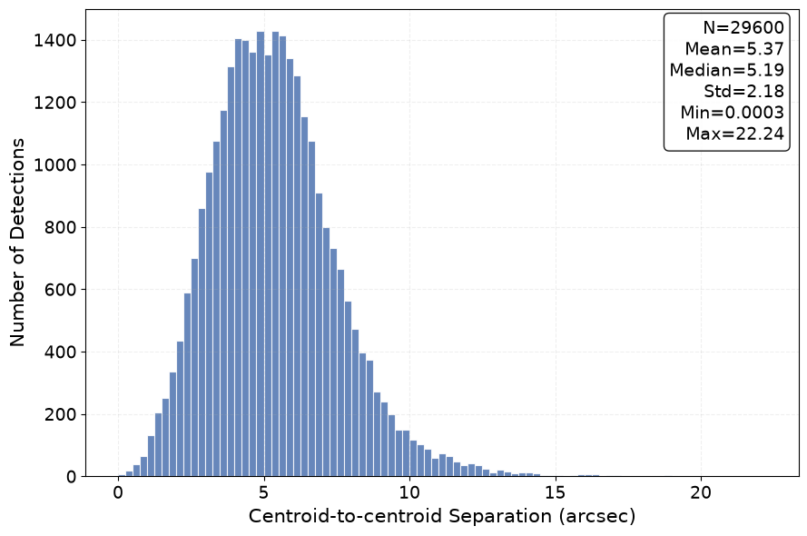
  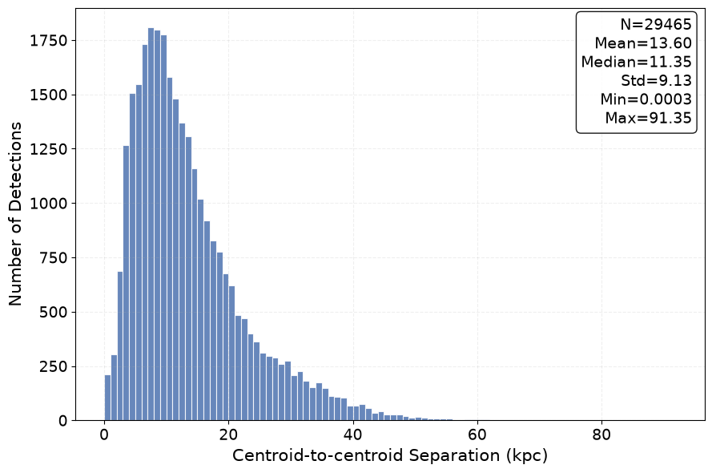

</p>

### Least Separation Estimated

<p align="center">
  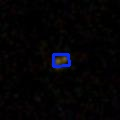
</p>


---

## Acknowledgement

The author sincerely thanks Professor Mousumi Das for the opportunity to work on this project and for her continuous guidance throughout the research.
Special thanks to Anwesh, the developer of the GOTHIC pipeline, for his insightful discussions and contributions during the development of this work. The author also thanks Snehanshu Sir for his guidance in machine learning research and methodology.
The computational experiments in this work were supported by the Param Shakti HPC facility at IIT Kharagpur. The author is grateful to Professor Somnath Bharadwaj and the faculty of IIT Kharagpur for their support and assistance.

---

## Citation

If you use this repository in your research, please cite:

## [`CITATION.cff`](CITATION.cff)

## License

This project is licensed under the MIT License.

See [`LICENSE`](LICENSE) for details.
